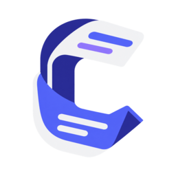

<h1 align="left"> Concordance</h1>

Concordance is a local-first tool for turning permitted conversation exports into searchable,
offline-readable archives. The first milestone is a normalized JSON schema and
a **Concordance** viewer that renders message text, timestamps, avatars,
replies, reactions, embeds, attachments, provenance, and offline status without
loading Discord or any external asset.

## Status

The MVP currently includes:

- a versioned normalized archive schema;
- validation with actionable error messages;
- a static HTML viewer with search, author filtering, timestamp modes, message
  selection, deep links, local image/audio/video previews, local-file links,
  print support, and responsive layout;
- a synthetic two-person fixture;
- a first-pass importer for Discord Data Package message JSON files; and
- a network-free adapter for user-supplied transcript JSON files.

Later work added the attended Discord Web capture adapter, guided capture
sessions, multi-archive catalogs, evidence reports, media materialization,
safe-share redaction and encrypted bundles. See the [usage guide](docs/USAGE.md)
and [capture guide](docs/CAPTURE.md).

The official Discord Data Package contains messages sent by the requesting
account, not a complete two-sided conversation. The importer preserves that
limitation in its metadata and records import diagnostics under
`metadata.source.import_summary` when files or records are skipped. A separate
user-supplied transcript adapter accepts explicitly provided JSON, while
acquisition remains separate from normalization and viewing.

## Install

Concordance requires Python 3.11 or newer. Install the wheel from a release or
install this repository in editable mode while developing:

```powershell
python -m pip install concordance-0.1.0-py3-none-any.whl

# From a source checkout:
python -m pip install -e ".[secure]"
concordance --help
```

The `concordance` command and `python -m concordance` entry point are equivalent.
The optional `secure` extra adds the cryptography dependency used for encrypted
share bundles.

## Quick start

Build and open the synthetic sample archive:

```powershell
$env:PYTHONPATH = "src"
python -m concordance validate fixtures/sample/archive.json
python -m concordance build fixtures/sample/archive.json --output dist/sample
python -m concordance verify dist/sample
Start-Process (Resolve-Path dist/sample/index.html)
```

## Documentation

| I want to… | Read |
| --- | --- |
| Build viewers and catalogs, import data packages, export evidence, redact or encrypt | [Usage guide](docs/USAGE.md) |
| Capture an open DM from Discord Web in verified ranges | [Capture guide](docs/CAPTURE.md) |
| Understand the normalized JSON schema | [Archive format](docs/ARCHIVE_FORMAT.md) |
| Set up a dev environment or open a pull request | [Contributing](CONTRIBUTING.md) |
| Report a vulnerability | [Security policy](SECURITY.md) |
| See what changed between versions | [Changelog](CHANGELOG.md) |

Agent and design notes live in [AGENTS.md](AGENTS.md), [PRODUCT.md](PRODUCT.md) and [DESIGN.md](DESIGN.md).

## Safety and privacy

The repository is for code and synthetic fixtures, not personal conversation
records. Keep real archives in an encrypted or otherwise access-controlled
location. Do not place Discord passwords, account tokens, or raw private chats
in source control.

## Codex plugin

This repository includes `plugins/concordance/`, a skills-only Codex plugin for
the authorized capture, offline archive, coverage verification, media audit,
and safe-sharing workflow. It is designed to be packaged or installed through
Codex without bundling any conversation data. The plugin does not extract
Discord tokens, run self-bots, crawl unattended, collect credentials, or write
back to Discord.

Its workflow is named `concordance-archive`; invoke `$concordance-archive` after
the plugin is installed in Codex.

Suggested positioning:

> Your Discord memories, readable offline—captured with permission, preserved
> locally.

Use “offline snapshot” or “portable archive,” not “rebuild your Discord
profile”: Concordance recreates the permitted viewing experience locally and
preserves available profile metadata, but it is not an account clone or a
Discord restore tool.

## License

MIT. See [LICENSE](LICENSE). Discord is a trademark of Discord Inc.; Concordance is not affiliated with or endorsed by Discord.

## AI Assistance Disclosure

This project was developed with assistance from OpenAI Codex for implementation,
archive-schema and viewer work, capture tooling, security hardening, release
checks, and documentation. The repository owner directed the work, reviewed and
tested the resulting changes, and remains responsible for the project's
security, accuracy, licensing, and final decisions.
